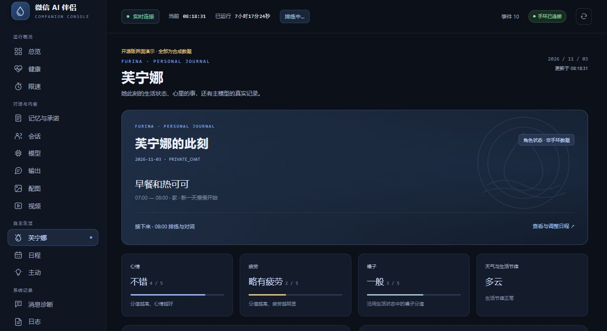
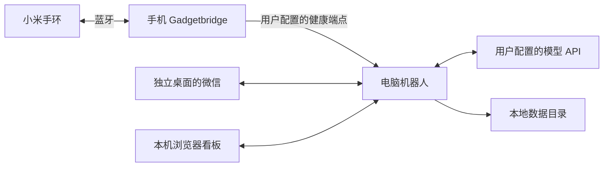

# WeChat Companion Suite

一套可以自行部署的微信 AI 群友与伴侣工具：电脑机器人、浏览器看板、Windows 独立桌面、Gadgetbridge 手机客户端和小米手环健康接入。

使用自己的微信账号、模型服务和设备配对。公开版提供通用示例人格与配置，运行数据保存在本地。

**自有内容采用非商业许可：允许非商业 AI 训练、微调和评测，禁止商业盈利用途。** 适用范围、上游许可与历史授权见 [许可说明](docs/LICENSING.md)。这是附有用途限制的公开源码项目。



图中聊天、状态与指标均为合成演示数据。

## 包含什么

| 部分 | 功能 | 源码 |
| --- | --- | --- |
| 微信机器人 | 群聊唤醒、自然接话、私聊、多模型分工、长期记忆与承诺 | `desktop/` |
| 浏览器看板 | 原始输入、接口返回的思考与输出、消息诊断、模型耗时、照片与视频记录 | `desktop/dashboard-src/` |
| 芙宁娜栏目 | 虚构角色状态、当前与下一段日程、承诺、准确关联的主模型记录 | 看板 `#furina` |
| 日程管理 | 异步生成、只重排剩余时间、锁定、历史版本恢复 | `desktop/companion_planner.py` |
| 独立桌面 | 微信与机器人在子会话运行、后台托盘、一键打开浏览器看板 | `desktop/isolated-desktop/` |
| 手机与手环 | 完整 Gadgetbridge 源码、小米设备支持、健康推送、真实连接状态、电量与心跳 | `mobile/gadgetbridge/` |
| 健康看板 | 活动、心率、睡眠、压力、血氧、数据新鲜度及日/周/月视图 | `desktop/dashboard_runtime.py` |
| 图片、语音、视频 | 可配置的图像生成、语音识别、视频理解和分享流程 | `desktop/image_prompting.py`、`desktop/video/` |



## 电脑端快速开始

电脑端运行需要 Windows、Python 3.12、Node.js，以及自己的微信登录。音视频处理还需要 FFmpeg 和适合平台的 SILK 解码器。独立桌面通过本地预检确认系统组件和账号绑定。

在 PowerShell 中运行：

```powershell
python -m venv .venv
.\.venv\Scripts\python.exe -m pip install -r requirements.txt
Copy-Item .env.example .env
Copy-Item desktop\bot-config.example.json desktop\bot-config.json
```

编辑本地 `.env` 与 `desktop/bot-config.json`，填写自己的模型密钥、模型名和需要监听的聊天对象。保留不用的功能为关闭状态。

```powershell
.\.venv\Scripts\python.exe desktop\wechat-bot.py --check-config
.\.venv\Scripts\python.exe tools\build-dashboard.py
.\tools\build-desktop.ps1
.\desktop\isolated-desktop\start-suite.ps1
```

首次在独立桌面中登录要用于机器人的微信账号，按启动器的本地绑定与预检提示完成配置。启动成功后，前台打开浏览器看板，子桌面收起到托盘。关闭浏览器不停止机器人。

配置项、构建工具和登录流程见 [电脑与独立桌面](docs/DESKTOP.md)。

## 手机与手环

仓库包含 `mobile/gadgetbridge/` 的完整应用源码及原有许可证，手机构建流程见 [手机接入](docs/MOBILE.md)。

1. 构建并安装你自己的 Gadgetbridge 包，使用自己的签名和设备配对。
2. 在手机中打开健康推送设置。
3. 填写电脑的健康接收地址与自己生成的推送令牌。
4. 与电脑端 `HEALTH_PUSH_TOKEN` 保持一致，再启用健康推送。
5. 在健康看板确认真实连接状态、电量和测量时间。

手机的推送开关默认关闭，地址与令牌由使用者配置。未测量、未上报和已过期的指标会分别显示，不以数据到达冒充蓝牙连接。

## 看板入口

默认地址为 `http://127.0.0.1:8765/console`。

- `#furina`：芙宁娜状态与主模型记录。
- `#diagnostics`：收到消息、触发判断、模型生成、微信发送四阶段。
- `#memory`：按会话与成员整理记忆、事实和承诺。
- `#life`：日程、锁定、局部重排和版本恢复。
- `#model`：实际模型分工、推理强度、成功率与耗时。
- `#health`：手机与手环状态、健康趋势。

思考栏只展示服务商实际返回的文本。旧调用没有准确会话归属时，不推测归入某个人的栏目。

## 隐私与数据

公开版按源码白名单整理，使用干净提交历史。账号、密钥、聊天、长期记忆、承诺实例、健康测量、设备绑定、照片、运行数据库、日志、签名材料和机器状态文件不属于发布内容。

- `.env`、本地配置、数据目录和签名文件受 `.gitignore` 保护。
- 机器人会在本机保存处理聊天和健康功能所需的数据；请自行管理数据目录与备份。
- 看板中的原始输入和模型返回可能包含你的私人内容，分享截图和日志前应再次检查。
- 健康推送只连接你设置的端点。在可信私有网络使用，不要把本机控制台直接转发到公网。

更多说明见 [隐私设计](docs/PRIVACY.md)。提交前可运行：

```powershell
python tools\privacy_check.py
python tools\privacy_check.py --staged
```

## 开发与验证

```powershell
python -m compileall -q desktop tools tests
python -m unittest discover -s tests/backend
python tools/build-dashboard.py
python tools/privacy_check.py
```

实际构建与检查结果见 [发布验证](docs/RELEASE_VALIDATION.md)。测试使用临时文件、假模型和合成数据，不需要个人账号或设备。

## 许可证

项目自有代码、文档与示例提示词采用 [WeChat Companion Noncommercial AI License 1.0](LICENSE)：允许学习、修改、非商业分发，以及非商业 AI 训练、微调、蒸馏和评测；商业收费、倒卖、广告变现和面向商业产品的模型训练不在授权范围内。

`mobile/gadgetbridge/` 继续遵循其自带的 **GNU AGPL-3.0-or-later** 和各文件版权声明；其中的美术资源另见 `LICENSE.artwork`。根目录非商业条款不限制该目录在原许可下的权利。此前合法获得的 MIT 授权继续有效，本次变更不追溯撤销；详见 [许可说明](docs/LICENSING.md)。

第三方组件按各自许可证分发，见 [THIRD_PARTY_NOTICES.md](THIRD_PARTY_NOTICES.md)。角色参考图由使用者自行提供有权使用的素材。
